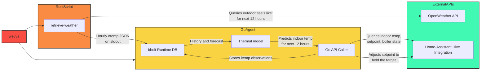

A Hive integration for the Home Assistant App.

This project is my learning introduction to rust as a Go developer.

## Overview

wevva is a small Go agent that keeps a Hive thermostat ahead of the weather. Every 15 minutes it will:

1) Use a bbolt runtime db to:
- Store the hourly outdoor 'feels like' temperature (otemp) forecast for the next 12 hours
- Record the indoor temperature (itemp), setpoint and boiler state it observes, keyed by timestamp
2) Run a Rust executable that fetches the next 12 hours of 'feels like' otemp values from the OpenWeather API
3) Query your Home Assistant Hive integration for the current indoor temperature
4) Predict the indoor temperature over the next 12 hours, and adjust your Hive thermostat via Home Assistant to hold a specified temperature as closely as possible

## High level diagram



## How it works

### The thermal model

With the heating off, a home cools towards the outdoor temperature at a rate proportional to the difference (Newton's law of cooling):

```
dT/dt = -k · (T_indoor - T_outdoor)
```

`k` is the home's cooling rate per hour. wevva starts with `k = 0.05` (a 20 hour time constant) and, once it has recorded enough history, fits `k` to your home by least squares. It only uses readings taken while the boiler was idle and had been idle for at least an hour, so radiators that are still warm don't skew the fit. The fit uses the last 7 days, so it follows the seasons.

Each cycle it simulates the indoor temperature for the next 12 hours with the heating off, using the hourly outdoor forecast. That prediction is logged (`passive_in_3h`, `passive_in_6h`, `passive_in_12h`; the full hourly series with `-debug`).

### The controller

A thermostat only reacts once the room has already cooled below its setpoint, and colder weather makes a room both cool faster and *feel* colder at the same air temperature, because the walls are colder. So wevva looks ahead (1 hour by default):

| Situation | Setpoint |
| --- | --- |
| The home would lose heat over the lookahead and fall below the target | target + the predicted loss, capped at `max-boost` |
| The home is warm enough to coast above the target through the lookahead | target |
| It's mild enough outside that the home wouldn't lose heat at all | target |

The setpoint is rounded to the thermostat's step (0.5 °C on Hive) and kept within its limits. For example, with a 20 °C target, `k = 0.05` and 0 °C outside, the home would lose about 1 °C an hour, so wevva sets 21 °C. At 10 °C outside it would lose about 0.5 °C, so it sets 20.5 °C.

### Staying out of the way

- wevva only changes the setpoint while the thermostat is in **heat** (manual) mode. In **auto** (schedule) or **off** mode it just observes, unless you allow `auto` with `-control-modes heat,auto`.
- It leaves the thermostat alone while a Hive **boost** is running.
- It only calls Home Assistant when the setpoint actually needs to change.
- When it stops (Ctrl-C or `systemctl stop`), it puts the setpoint back to the target if it had raised it, unless someone has changed it by hand since.
- `-dry-run` does everything except change the thermostat.
- If OpenWeather can't be reached, it carries on with the forecast it stored last time.

Note that in heat mode wevva owns the setpoint: if you change it by hand, wevva will set it back on the next cycle. To change the temperature, change the target (`WEVVA_TARGET_TEMP`), or stop wevva.

## Getting started

You'll need:

- Go 1.25 or later and a stable Rust toolchain (`rustup`)
- Home Assistant with the [Hive integration](https://www.home-assistant.io/integrations/hive/), and a long-lived access token (your HA profile → Security → Long-lived access tokens)
- An [OpenWeather API key](https://home.openweathermap.org/api_keys). The free key works with the default 5 day / 3 hour forecast API. If you subscribe to One Call 3.0, set `WEVVA_WEATHER_API=onecall` for true hourly data.

Build both executables into `bin/`:

```sh
make build
```

Configure it:

```sh
cp .env.example .env
$EDITOR .env      # set WEVVA_HA_URL, WEVVA_HA_TOKEN, WEATHER_API_KEY and your target
```

Try one cycle without touching the thermostat:

```sh
make dry-run
```

```
level=INFO msg=observed indoor=19.6 outdoor_feels_like=1.2 setpoint=20 mode=heat action=idle
level=INFO msg=predicted cooling_rate_per_hour=0.05 time_constant=20h0m0s fitted_pairs=0 passive_in_3h=17 passive_in_6h=14.5 passive_in_12h=10.3
level=INFO msg=decided setpoint=21 why="with the heating off the home would lose 0.9°C over the next 1h" result="dry run: would change 20.0°C to 21.0°C"
```

Then run it for real:

```sh
make run
```

`make` reads `.env` for you. To run `bin/wevva` directly, export the same variables or pass flags (`bin/wevva -h` lists them).

### Configuration

Every setting can be an environment variable or a flag; flags win. The two secrets can only come from the environment.

| Variable | Flag | Default | |
| --- | --- | --- | --- |
| `WEVVA_HA_URL` | `-ha-url` | | Home Assistant URL, e.g. `http://homeassistant.local:8123` |
| `WEVVA_HA_TOKEN` | | | Home Assistant long-lived access token |
| `WEVVA_CLIMATE_ENTITY` | `-entity` | `climate.heating` | The Hive thermostat entity |
| `WEATHER_API_KEY` | | | OpenWeather API key |
| `WEVVA_WEATHER_API` | `-weather-api` | `forecast` | `forecast` (free) or `onecall` (One Call 3.0) |
| `WEVVA_LATITUDE`, `WEVVA_LONGITUDE` | `-lat`, `-lon` | Home Assistant's | Where to get the forecast for; west is negative |
| `WEVVA_TARGET_TEMP` | `-target` | `20` | The temperature to hold, °C |
| `WEVVA_MAX_BOOST` | `-max-boost` | `1` | Most to raise the setpoint above the target; `0` turns anticipation off |
| `WEVVA_LOOKAHEAD` | `-lookahead` | `1h` | How far ahead to anticipate heat loss |
| `WEVVA_CONTROL_MODES` | `-control-modes` | `heat` | HVAC modes wevva may adjust: `heat`, `auto` |
| `WEVVA_INTERVAL` | `-interval` | `15m` | Time between cycles |
| `WEVVA_DB` | `-db` | `wevva.db` | The bbolt database file |
| `WEVVA_FETCHER` | `-fetcher` | found automatically | Path to `retrieve-weather`; by default wevva looks next to itself, then on `PATH` |
| `WEVVA_DRY_RUN` | `-dry-run` | `false` | Decide, but never change the thermostat |
| `WEVVA_DEBUG` | `-debug` | `false` | Also log the full hourly prediction |
| | `-once` | | Run one cycle and exit |
| | `-history 24h` | | Print what was recorded over that period and exit |

### What it has recorded

```sh
bin/wevva -history 24h
```

```
Observations since Mon 26 Oct 19:31

       time  indoor  outdoor  heating  setpoint  mode
  Mon 20:31    19.6      1.2       no      21.0  heat
  ...

Outdoor forecast

       time  feels like
  Mon 20:00         1.3
  Mon 21:00         1.0
  ...
```

This works while the agent is running: the agent only holds the database open during a cycle. Data older than 30 days is pruned.

### Running as a service

`deploy/wevva.service` is a hardened systemd unit. The install steps are at the top of the file. In short: copy both executables to `/usr/local/bin`, your `.env` to `/etc/wevva/wevva.env`, then `systemctl enable --now wevva`. The database lives in `/var/lib/wevva`.

## The Rust fetcher

`rust/retrieve-weather` is a standalone CLI, so it can be run on its own:

```sh
WEATHER_API_KEY=... bin/retrieve-weather --lat 51.5074 --lon=-0.1278 --hours 12
```

It prints one JSON document on stdout, with one entry per hour starting at the current hour (UTC). The free API only has a point every 3 hours, so the hours in between are linearly interpolated:

```json
{
  "provider": "openweather-forecast-2.5",
  "latitude": 51.5074,
  "longitude": -0.1278,
  "generated_at": 1792960000,
  "hours": [
    { "timestamp": 1792958400, "feels_like_celsius": 1.33 },
    { "timestamp": 1792962000, "feels_like_celsius": 1.0 }
  ]
}
```

On failure it prints the reason to stderr and exits non-zero, and the Go agent includes that message in its log. The API key is read from the environment and is never included in error messages.

## Development

```sh
make test   # Go tests (with -race) and Rust tests
make lint   # gofmt, go vet, cargo fmt --check, clippy
```

CI runs both on every push and pull request (`.github/workflows/ci.yml`).

```
cmd/wevva/             the agent's entry point
internal/app/          the control loop: fetch, observe, predict, act
internal/config/       flags and environment variables
internal/db/           bbolt storage for forecasts and observations
internal/hive/         Home Assistant REST client for the Hive climate entity
internal/thermal/      cooling model, fitting and setpoint decisions
internal/weather/      runs retrieve-weather and parses its output
rust/retrieve-weather/ the OpenWeather fetcher
deploy/                systemd unit
```

## Limitations

- The model only knows about outdoor temperature. Sun through the windows, cooking and occupancy all warm a home, and wevva can't see them. They show up as noise in the fitted cooling rate, which is clamped to a sensible range.
- Hive reports the temperature at the thermostat, so the whole home is modelled as that one room.
- In schedule (`auto`) mode, Hive treats a setpoint change as an override until the next scheduled change, which is why wevva leaves `auto` alone by default.
